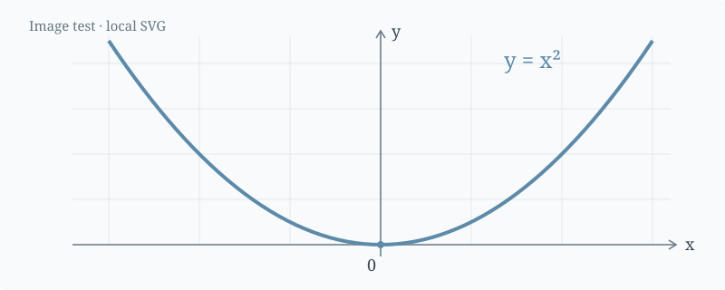

# MyCVBlog

**English** | [简体中文](README.zh-CN.md)

<!-- Project badges -->
[](package.json)
[](LICENSE.md)


[](https://github.com/QTH1225/MyCVBlog/releases)
[](https://github.com/QTH1225/MyCVBlog/stargazers)

A static personal blog with a résumé homepage, projects, work experience, honors and awards, publications, extracurricular activities, and notes. The homepage keeps a compact résumé layout: use **View all →** to open a category, then select an entry for its detail page. The website itself is English-only; this documentation is available in English and Chinese.

Adapted from **Vaishanth R**'s [Resume Professional Template - Software Engineer](https://www.overleaf.com/latex/templates/resume-professional-template-software-engineer/ttwtyxskrcsz). The Overleaf template page lists [CC BY 4.0](https://creativecommons.org/licenses/by/4.0/). This project's original and adapted contributions use [CC BY-SA 4.0](https://creativecommons.org/licenses/by-sa/4.0/); the original material and third-party resources retain their own licenses. See the attribution section below and [LICENSE.md](LICENSE.md).

## Features

- **Edit Markdown directly.** Maintain résumé entries, projects, experience, activities, and publications in documents without editing JavaScript arrays or generating source code.
- **Résumé styling.** Locally bundled Charter fonts, muted blue headings, thin rules, bold titles, and right-aligned dates. Shared identity headers appear on category and detail pages. Return links sit to the right of the title: details return to their category, and categories return to the résumé.
- **Mobile layout.** Contact details balance according to their number and rendered width: three short items share a row, four use 2+2, and five use 3+2 with the last row centered when space permits. Longer labels wrap into fewer items per row. Activity dates move to their own left-aligned line on phones. Automatic number/date linking is disabled where supported, while explicit contact links stay clickable.
- **Separate previews and details.** A project's `## Summary` section supplies its homepage preview; the remaining sections form the detail page. The activity preview shows only the role, club, and date.
- **Images and mathematics.** Project bodies and notes support Markdown images, KaTeX equations, code, tables, and quotations. Equations are rendered at build time and fonts are bundled locally.
- **Static output.** Generate plain HTML/CSS and assets for static hosting, offline reading, mobile layouts, and printing, without a frontend framework or an online CDN at reading time.
- **Page transitions.** An early light background and preloaded regular, bold, and italic fonts reduce loading flashes. Supporting browsers use a short native transition between same-origin pages; reduced-motion settings disable it. Contact rows are only rebuilt when their grouping changes.
- **Validation.** Check metadata, filenames, local links, fonts, English pages, and sample mathematics. Content parser tests are included.

The sample identity uses an anonymous name, masked phone number, and example links. Some projects, roles, publications, and activities are illustrative entries. Replace them with your own public information before using the site as a personal résumé.

## Quick Start

Use **Node.js 22.12.0 or newer** and npm, matching the package requirement and locked dependencies. LaTeX and Python are not required for everyday use.

```powershell
npm ci
npm run dev
```

Open the [local homepage](http://127.0.0.1:4173/index.html). Content changes trigger a rebuild; refresh the browser to see them.

| Command | Purpose |
| --- | --- |
| `npm ci` | Install the locked dependencies |
| `npm run dev` / `npm start` | Build and start the local preview on port 4173 |
| `npm run build` | Generate `dist/` without starting a server |
| `npm run check` | Check generated pages and assets |
| `npm test` | Test content parsing, additions, edits, ordering, and removal |

If the port is occupied, run `$env:PORT = '4174'` in PowerShell before `npm run dev`. The server listens only on `127.0.0.1`. Restart it after changing its implementation.

## Where to Edit Content

Start with the [Chinese content editing guide](content/README.md), or edit the files below. Files in `content/` and `templates/` are not copied verbatim into the website; note sources are available as public downloads.

| Content | Source |
| --- | --- |
| Homepage section order | [content/home.md](content/home.md) |
| Name, phone, email, and profile links | [content/profile.md](content/profile.md) |
| Education and courses | [content/education.md](content/education.md) |
| Skills | [content/skills.md](content/skills.md) |
| Honors and competition awards | [content/honors-and-awards.md](content/honors-and-awards.md) |
| Publications | [content/publications.md](content/publications.md) |
| Projects | One Markdown file per project in `content/projects/` |
| Work experience | One Markdown file per role in `content/work-experience/` |
| Extracurricular activities | One Markdown file per activity in `content/extracurricular-activities/` |
| Notes | One Markdown file per note in `notes/` |

**Do not edit `dist/` directly.** Each build replaces this generated directory, including old pages, note sources, and assets. Store content and attachments in their source directories.

### Homepage Section Order

Edit [content/home.md](content/home.md). Move an entire list line up or down to change the order of the homepage sections:

```markdown
- education
- skills
- projects
- work-experience
- honors-and-awards
- publications
- extracurricular-activities
- notes
```

For example, move `- publications` above `- skills` to show publications before skills. Keep all eight identifiers exactly once, using the names above; blank lines are allowed. Duplicate, unknown, or missing sections stop the build with a `content/home.md` error and preserve the last working output. Restart the preview server once after updating the build scripts, then edits to `home.md` trigger a rebuild; refresh the browser to view them. This controls homepage section order; the `order` field in individual project, work experience, and activity files controls entries within those sections. Category and detail page layouts stay the same, and the homepage Notes section stays hidden when printing wherever it is placed.

## Projects, Experience, and Activities

Try editing the [existing project example](content/projects/conductive-concrete-example.md), or copy a template:

```powershell
Copy-Item templates/project.md content/projects/my-project.md
Copy-Item templates/work-experience.md content/work-experience/my-role.md
Copy-Item templates/activity.md content/extracurricular-activities/my-activity.md
```

The filename becomes the entry's URL identifier. Use lowercase letters, numbers, and hyphens. For example, `my-project.md` generates `projects/my-project/index.html`; the other categories follow the same pattern. Renaming a file changes its URL, and removing a file removes its page on the next build. Update references accordingly. Keep category directories in place; remove their files to empty a category.

A project file looks like this:

```markdown
---
title: My Project
order: 1
subtitle: Research project
dates: 2025 - 2026
---

## Summary

- A short overview for the homepage.
- Another key point.

## PROJECT OVERVIEW

Write the full introduction here.

## RESULTS



Inline math: $\sigma = E\varepsilon$.
```

- `title` is required. `subtitle`, `dates`, `location`, and `funding` are optional.
- Lower `order` values appear first. The default is 999; ties are sorted by filename.
- `## Summary` is optional and may appear only once. It supplies homepage and category previews and is omitted from the detail body. Short bullet points work well here.
- All other sections form the detail page. Use `##` for sections and `###` for subsections, with ordinary Markdown content below them.
- The `---` header supports single-line fields rather than full YAML. Each field may appear only once. Invalid fields produce an error identifying the source file.

Work experience uses the same format. Activities additionally require `role`, `organization`, and `dates`: their homepage preview shows the bold role and club on the left and italic dates on the right. `subtitle` is used on category and detail pages and does not change the compact homepage preview.

## Profile, Education, Skills, Awards, and Publications

### Profile

Edit `content/profile.md`, preserving the opening and closing `---`:

```text
---
name: Anonymous
phone: +86 1XX-XXXX-XXXX
email: hello@example.com
website: https://example.com/
websiteLabel: example.com
github: https://github.com/
githubLabel: GitHub
---
```

Only `name` is required. Remove a contact field's entire line to omit it. The name also appears in page headers, browser titles, and footers. Masked numbers are plain text, while numeric phone numbers receive dialing links. If you change the public adapter attribution, update the license documents as well.

To add a fifth contact or more, append a `## Contacts` section **after the closing `---`** in `content/profile.md`:

```markdown
## Contacts

- [LinkedIn](https://www.linkedin.com/in/your-handle/)
- [Google Scholar](https://scholar.google.com/)
```

Each item must be a plain Markdown link using `https://`, `http://`, `mailto:`, or `tel:`. These links follow the existing phone, email, website, and GitHub fields in list order. A small locally bundled script measures the loaded font and available width to balance the rows without changing that order. On narrow screens it uses at most three contacts per row, favors even row counts, and centers every row; long addresses can wrap on their own line. Desktop and printed contacts can share one row when they fit. The links remain available with JavaScript disabled, using ordinary centered wrapping.

### Education and Skills

Use one `##` heading for each institution, in display order:

```markdown
## University

location: City
degree: Bachelor of Engineering
dates: 09 2021 - 06 2025

### Courses

- Mechanics: Statics, Dynamics
- Professional: Structural Design
```

`degree` and `dates` are required. `location` and `### Courses` are optional. Write course groups as `- Label: courses`; keep the metadata above the course list.

Skills are bullet points in `content/skills.md`:

```markdown
- **Programming Languages:** Python, MATLAB, LaTeX
- **Professional Interests:** Engineering and simulation
```

### Honors and Awards

Edit the two tables in `content/honors-and-awards.md`:

```markdown
## Honors

| Name | Date |
| --- | --- |
| First-class Scholarship | Nov. 2024 |

## Awards

| Name | Date |
| --- | --- |
| Competition Award | May 2024 |
```

Keep the `Name` and `Date` headers, and add or remove rows. Escape a vertical bar in a name as `\|`. The homepage shows up to five entries in each group; View all shows the complete lists.

### Publications

Use one second-level heading per paper in `content/publications.md`:

```markdown
## My Paper Title

id: my-paper
authors: **Author A**, Author B, Author C
journal: Journal Name
year: 2026
url: https://example.com/paper
```

`id`, `authors`, `journal`, and `year` are required. The identifier must be unique and contain only lowercase letters, numbers, and hyphens. Use `**Name**` to emphasize an author without creating an object. `url` is optional: titles without it link to the local detail page; titles with it link to the external paper. Publications retain the three-line format of title, authors, and journal with year, without contribution bullets.

## Notes, Images, and Equations

Copy `templates/note.md` to `notes/my-note.md`. Provide `title`, a valid `YYYY-MM-DD` `date`, `summary`, and optional `tags`. Notes are sorted newest first. The homepage shows at most five; View all shows the full list. Homepage and category lists show only titles and dates. Detail pages retain summaries and tags and offer Markdown downloads.

Place images in `assets/images/`. Projects and notes use the same syntax:

```markdown


*Figure 1. Image caption.*

Inline math: $\sigma = E\varepsilon$.

$$
\int_0^1 x^2\,\mathrm{d}x = \frac{1}{3}
$$

[Supporting note](note:media-math-test)
```

PNG, JPG, WebP, SVG, and other browser-supported formats work. Local images are recommended for offline use. Equations support KaTeX syntax, including subscripts, fractions, integrals, matrices, and `aligned`. Long equations, code blocks, and tables scroll within their own containers. Dollar signs inside code remain literal; escape an ordinary dollar sign in prose as `\$`. Raw HTML is not executed.

Links support full HTTP(S) URLs, `assets/...`, `#anchors`, and `note:filename` without `.md`. References to missing notes fail the build. Bare URLs are not automatically linked, and arbitrary relative page links are not currently supported.

## Styling, Builds, and Deployment

| Setting | File |
| --- | --- |
| Colors, fonts, sizes, spacing, width, mobile layout, and printing | `src/styles.css` |
| Headings, View all, and return labels | `src/labels.mjs` |
| Homepage section order | `content/home.md` |
| Preview limits, header, and footer structure | `scripts/build.mjs` |
| Favicon | `assets/favicon.svg` |

Routine content editing does not require these files. To change preview limits, edit `honors.slice(0, 5)` and `awards.slice(0, 5)` for awards or `notes.slice(0, 5)` for notes.

The development server watches files directly inside `content/`, its three entry directories, `notes/`, `src/`, `assets/`, and `assets/images/`. Manually rebuild resources added in deeper directories. Refresh the browser after saving. Restart a server started before the Markdown migration to enable its new content watchers.

Before publishing, run:

```powershell
npm test
npm run build
npm run check
```

Deploy **all files inside `dist/`** to static hosting, preserving asset, category, and note directories. Include the generated `.nojekyll` marker when using GitHub Pages so directories such as `notes/_sources/` are served. Relative links support hosting at a domain root or subdirectory. Node.js is not required on the web server. You can also open `dist/index.html` offline or print the page to PDF from a browser.

Charter fonts load locally. KaiTi remains a system-font fallback and is not distributed. KaTeX fonts and license notices are bundled. This is a file-based static blog without an online editor, authentication, database, or comments. Confirm that your content and attachments are suitable for public sharing, including downloadable note sources.

### Printing to PDF

Open the homepage, press **Ctrl+P** (or **Cmd+P** on macOS), and choose **Save as PDF**. Use **A4**, **100% scale**, the default margins, and turn off the browser's headers and footers. The print stylesheet keeps the locally bundled Charter fonts, uses dark text, and hides navigation, View all links, the website footer, and the homepage Notes section. It prints the other content already shown on the page; it does not expand the full category lists. Page count depends on your content. Detail pages, including individual notes, can also be printed.

Print layout is defined by `@page` and `@media print` in `src/styles.css`: A4 paper with 14 mm margins, right-aligned dates, and page-break rules that try to keep headings with their content, award lists together, and images with their captions. Long code lines wrap when printed. Mobile layout rules apply only to screens. The homepage Notes section is marked with `class="resume-notes"` in `scripts/build.mjs` and hidden only in print, so it remains visible when browsing.

The PDF preview for this update was exported with Playwright driving a local headless Microsoft Edge browser. It loaded the local preview server, waited for `document.fonts.ready`, and called `page.pdf()` with `preferCSSPageSize: true`, `scale: 1`, `displayHeaderFooter: false`, and `printBackground: true`. The browser rendered the site's HTML/CSS directly, preserving selectable text and links. Playwright was used as a verification tool; `npm run build` continues to generate the static website, and PDF export is performed separately.

### Troubleshooting

- **Changes do not appear:** put files in `content/` or `notes/`, not in the template directory. Rebuild and refresh; restart an older server to load the new watchers.
- **Metadata errors:** use the English field names from a template, keep values on one line, and retain the `---` markers. Do not paste JavaScript arrays.
- **An entry is missing:** check its `.md` extension and directory. Collection files such as education and publications use `##` headings.
- **An image is missing:** check filename casing and use `assets/images/...` consistently.
- **An equation fails:** check its delimiters and KaTeX syntax. KaTeX is not a complete LaTeX environment.

## Source, Changes, and Attribution

| Item | Details |
| --- | --- |
| Original work | Resume Professional Template - Software Engineer |
| Original author | **Vaishanth R** |
| Source | [Overleaf template page](https://www.overleaf.com/latex/templates/resume-professional-template-software-engineer/ttwtyxskrcsz) |
| Original license | [CC BY 4.0](https://creativecommons.org/licenses/by/4.0/), as listed on the template page |
| Adaptation | MyCVBlog |
| Adapter attribution | Anonymous |
| Original and adapted contributions | [CC BY-SA 4.0](https://creativecommons.org/licenses/by-sa/4.0/) |

Changes include reimplementing the LaTeX résumé style in HTML/CSS, adding category and detail pages, Markdown content editing, notes, images and mathematics, static builds and checks, and replacing displayed content. The original author did not participate in these changes; attribution does not imply endorsement.

Source checked on 2026-10-15: the Overleaf license field lists CC BY 4.0, while the displayed LaTeX source header says `License : MIT`. This discrepancy is recorded here rather than treated as confirmation of dual licensing.

You may retain the following attribution when reusing the project and add your own change notice:

> MyCVBlog, adapted by Anonymous from Vaishanth R's Resume Professional Template - Software Engineer ([original work](https://www.overleaf.com/latex/templates/resume-professional-template-software-engineer/ttwtyxskrcsz), listed as CC BY 4.0 on Overleaf). This adaptation adds an English website, project detail pages, Markdown content editing, and notes. Original and adapted contributions use CC BY-SA 4.0. The original and third-party license terms continue to apply.

## License

Contributions for which the adapter holds the relevant rights, including original website implementation, styling, documentation, and example content, use **Creative Commons Attribution-ShareAlike 4.0 International (CC BY-SA 4.0)**. Preserve appropriate attribution, source and license links, and change notices. Share adaptations of these contributions under the applicable ShareAlike terms. Commercial use is permitted; the [full legal text](https://creativecommons.org/licenses/by-sa/4.0/legalcode.en) controls the terms.

Original material retains its original license. This notice does not replace the original CC BY 4.0 grant or restrict direct reuse under it. See the [Creative Commons guidance on adaptations](https://creativecommons.org/faq/#if-i-derive-or-adapt-material-offered-under-a-creative-commons-license-which-cc-license-can-i-apply-to-the-resulting-work).

- Charter Web fonts retain the [Bitstream license and conversion notice](assets/fonts/LICENSE.txt).
- KaTeX retains its package license, copied to `dist/assets/katex/LICENSE.txt`.
- markdown-it, markdown-it-texmath, and other dependencies retain their respective package licenses.
- Separately identified third-party images, quotations, and attachments follow their own terms and are not automatically covered by this project's license.

See [LICENSE.md](LICENSE.md) for the English project notice or its [Chinese version](LICENSE.zh-CN.md); the two files link to each other. The [English attribution notice](assets/ATTRIBUTION.md) and its [Chinese version](assets/ATTRIBUTION.zh-CN.md) also include language-switch links and are copied to `dist/assets/` with the website. Preserve the README files, both license and attribution notices, and third-party notices when redistributing the source.

## Star History

If this project is helpful to you, please consider giving it a star ⭐. Thank you!

<a href="https://star-history.com/#QTH1225/MyCVBlog&amp;Date">
  <picture>
    <source media="(prefers-color-scheme: dark)" srcset="https://api.star-history.com/svg?repos=QTH1225/MyCVBlog&amp;type=Date&amp;theme=dark" />
    <source media="(prefers-color-scheme: light)" srcset="https://api.star-history.com/svg?repos=QTH1225/MyCVBlog&amp;type=Date" />
    
  </picture>
</a>
